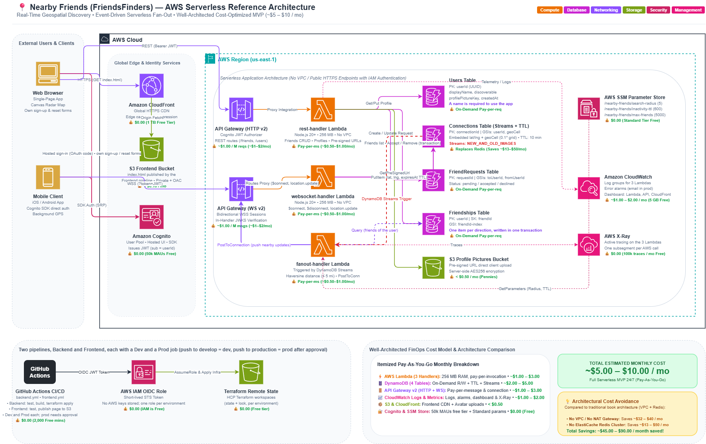

# 📍 Nearby Friends

A serverless backend and web frontend for real-time location sharing between friends. Opted-in users share their location and see friends (and optionally strangers) who are geographically within a configurable radius. Built on AWS with Terraform and TypeScript.

> **Note:** This project is built for academic purposes. The architecture is designed to be correct and well-structured but does not target production-scale traffic.

---

## 🎯 Features

- User authentication via Amazon Cognito: create an account with a name, confirm it by email code, sign in, and reset a forgotten password
- Real-time location sharing via persistent WebSocket connections
- Friends list with live distance and last-updated timestamp
- Live **Map** tab — a tile-free radar plotting friends by distance and bearing
- Nearby strangers discovery — find and connect with non-friends who opted in (ordered by proximity)
- Friend requests — send, accept, or decline
- User profiles with a required display name and a discoverability toggle
- Profile pictures uploaded directly to S3 via pre-signed URLs
- Configurable radius, TTL, friend limits via SSM Parameter Store
- Automatic inactivity cleanup via DynamoDB TTL (10-minute timeout)
- Single-page web frontend (one self-contained `index.html`) served via CloudFront

---

## 🏗️ Architecture

```
Browser / Mobile Client
     │
     ├── HTTPS ──────► CloudFront ──► S3 (index.html)
     │
     ├── WebSocket ──► API Gateway v2 (WebSocket API)
     │                    ├── $connect            ┐
     │                    ├── $disconnect         │
     │                    ├── location.update     ├── websocket-handler Lambda
     │                    └── friends.refresh     ┘
     │
     └── HTTPS ──────► API Gateway v2 (HTTP API) [JWT authorizer → Cognito]
                         ├── GET    /friends
                         ├── DELETE /friends/{friendId}
                         ├── GET    /nearby-friends
                         ├── GET    /nearby-strangers
                         ├── POST   /friend-requests/{toUserId}     ├── rest-handler Lambda
                         ├── GET    /friend-requests
                         ├── PUT    /friend-requests/{requestId}/accept|decline
                         ├── GET    /users/{userId}/profile
                         ├── PUT    /users/{userId}/profile
                         └── GET    /users/{userId}/profile-picture-upload-url

DynamoDB Streams (Connections table) ──► fanout-handler Lambda ──► PostToConnection (push to clients)
```



The diagram above is [`Friend-finder_architecture.drawio`](generated-diagrams/Friend-finder_architecture.drawio) (open it in draw.io or the VS Code draw.io extension; the PNG is its export, so re-export it after changing the diagram). The files live in [`generated-diagrams/`](generated-diagrams/). [`Friend-finder_MVP.png`](generated-diagrams/Friend-finder_MVP.png), made by [`generate_architecture.py`](generated-diagrams/generate_architecture.py), is the earlier version and is kept for history only.

### AWS Services

| Service                    | Purpose                                                               |
| -------------------------- | --------------------------------------------------------------------- |
| Amazon Cognito             | User sign-up, sign-in, JWT issuance                                   |
| API Gateway v2 (WebSocket) | Persistent bidirectional connections for real-time updates            |
| API Gateway v2 (HTTP)      | REST endpoints with Cognito JWT authorizer                            |
| AWS Lambda (3 handlers)    | All business logic — no VPC required                                  |
| Amazon DynamoDB (4 tables) | Users (profiles), Friendships, Connections (with location, TTL and a geoCell index), FriendRequests |
| DynamoDB Streams           | Triggers fan-out on location updates                                  |
| Amazon S3 (2 buckets)      | Profile picture storage; frontend hosting (`index.html`)              |
| Amazon CloudFront          | HTTPS delivery of the web frontend                                    |
| AWS SSM Parameter Store    | Runtime-configurable parameters                                       |
| CloudWatch                 | Log groups and alarms per Lambda                                      |

### DynamoDB Tables

| Table          | PK           | SK | GSI                  | TTL       | Notes                                          |
| -------------- | ------------ | -- | -------------------- | --------- | ---------------------------------------------- |
| Users          | userId       | —        | —                    | —         | Profile only                                   |
| Friendships    | userId       | friendId | friendId-index       | —         | One item per direction, written in a transaction |
| Connections    | connectionId | —        | userId-index, geoCell-index | expiresAt | Embeds location + drives fan-out via Streams    |
| FriendRequests | requestId    | —        | toUserId, fromUserId | —         |                                                |

> **Note:** Friend relationships live in their own `Friendships` table, one item per direction (`userId` → `friendId`). Accepting a friend request creates both items and deletes the request in a single DynamoDB transaction, and removing a friend deletes both items in one, so a friendship is never half-created or half-removed. Keeping friends out of the `Users` item keeps profile reads small and removes any per-user size limit.

The Connections table embeds location data (latitude, longitude, timestamp) alongside connection state. DynamoDB Streams (NEW_AND_OLD_IMAGES) on this table triggers the fanout-handler when location updates occur.

**Finding nearby strangers.** The map is cut into a grid of 0.1° squares (about 7 miles). Every location update also stores the key of the square the connection is in (`geoCell`, e.g. `1106:766`), and the sparse `geoCell-index` is built on it. `GET /nearby-strangers` works out which few squares can contain anyone within the search radius (`src/utils/geo-cells.ts`), queries just those, and then measures the exact Haversine distance. The cost depends on how many people are nearby, not on how many connections exist. If the radius is so large, or the user so close to a pole, that more than 25 squares are needed, it falls back to a scan of the table capped at 20 pages (it logs a warning if it stops early).

---

## 🔐 Authentication

- **Web frontend:** sign in through the Cognito **hosted UI** (OAuth 2.0 authorization code flow: the browser receives a `code` and exchanges it for a JWT `id_token`), or use the app's own **Create account** and **Forgot password** forms, which call Cognito directly (confirm with an emailed code, then sign in with `USER_PASSWORD_AUTH`). The token is sent as `Authorization: Bearer <id_token>` on REST calls and as `?token=<id_token>` on WebSocket connect.
- **Mobile:** Direct auth via the Cognito SDK (`USER_SRP_AUTH` / `USER_PASSWORD_AUTH`) using a separate mobile client ID; identical token usage.
- **Identity:** The Cognito `sub` claim (a stable UUID per user) is used as `userId` throughout the system. The WebSocket handler verifies the token manually via JWKS; the HTTP API uses API Gateway's built-in JWT authorizer.

---

## 🔧 Tech Stack

**Backend**

- Node.js + TypeScript (strict, ESNext, CommonJS)
- AWS SDK v3 modular (`@aws-sdk/client-dynamodb`, `@aws-sdk/lib-dynamodb`, `@aws-sdk/client-apigatewaymanagementapi`, `@aws-sdk/client-s3`, `@aws-sdk/s3-request-presigner`, `@aws-sdk/client-ssm`)
- `jsonwebtoken` + `jwks-rsa` (WebSocket JWT verification)
- `esbuild` for Lambda bundling
- Jest + ts-jest, `fast-check` (property tests), `aws-sdk-client-mock` and `jsdom` (web app tests) for testing

**Frontend**

- Single-page app — vanilla HTML, CSS, and JavaScript in one self-contained `index.html` (no framework, no build step)
- Cognito hosted UI for sign-in, plus the page's own create-account, confirm-code and reset-password forms (calling Cognito's API directly)
- `<canvas>` radar map — no map tiles or external map service

**Infrastructure**

- Terraform (no CDK, SAM, or Serverless Framework)
- Terraform state and locking — HCP Terraform (one workspace per environment)
- GitHub Actions — CI on pull requests, automatic deploy of `dev` on push to `develop` and of `prod` on push to `production` after approval (OIDC for AWS)

---

## 📁 Project Structure

```
/
├── .github/workflows/
│   ├── ci.yml                      # pull requests: type-check, test, build, terraform fmt/validate
│   ├── deploy-environment.yml      # reusable: build + terraform apply for one environment
│   ├── deploy-dev.yml              # push to develop -> dev
│   └── deploy-production.yml       # push to production -> prod, after approval
├── frontend/
│   └── index.html                  # Entire web app — HTML + CSS + JS, deployed as-is
├── terraform/
│   ├── main.tf                     # incl. the HCP Terraform (cloud) block that holds the state
│   ├── cicd.tf                     # GitHub OIDC provider + CI deploy role
│   ├── envs/                       # per-environment settings: dev.tfvars, prod.tfvars
│   ├── variables.tf, outputs.tf
│   └── modules/
│       ├── api-gateway/    ├── lambda/          ├── dynamodb/
│       ├── cognito/        ├── frontend/        ├── frontend-deploy/
│       ├── iam/            ├── ssm/             ├── s3/
│       └── monitoring/
├── src/                            # Lambda handlers (backend)
│   ├── handlers/
│   │   ├── websocket-handler.ts    # $connect, $disconnect, location.update, friends.refresh
│   │   ├── rest-handler.ts         # All REST routes
│   │   └── fanout-handler.ts       # DynamoDB Streams → push to friends
│   ├── utils/
│   │   ├── distance.ts             # Haversine formula
│   │   ├── geo-cells.ts            # 0.1° grid squares behind the nearby-strangers index
│   │   ├── validation.ts           # Location update validation
│   │   ├── profile-validation.ts   # Profile update validation
│   │   ├── dynamo-client.ts        # DynamoDB wrappers (incl. transactional friendships)
│   │   ├── apigw-client.ts         # API Gateway Management API
│   │   ├── s3-client.ts            # S3 pre-signed URL helpers
│   │   ├── config.ts               # SSM parameter loader (cached, validated)
│   │   └── message-utils.ts        # WebSocket message builders/parsers
│   └── types/index.ts              # Shared TypeScript interfaces
├── tests/
│   ├── unit/                       # Handler and wrapper tests (AWS is always mocked)
│   ├── property/                   # fast-check property tests
│   ├── frontend/                   # The web app in a simulated browser (jsdom)
│   └── helpers/                    # Shared test builders
├── scripts/
│   ├── build.js                    # esbuild bundler → dist/<handler>.zip
├── docs/                           # Product, technology and architecture documentation
│   ├── product.md                  # What the app does and its API
│   ├── tech.md                     # Stack, settings and commands
│   └── architecture.md             # How it is built, failure handling and design decisions
├── generated-diagrams/             # Architecture diagrams (PNG + draw.io)
├── dist/                           # Generated Lambda bundles + zips
├── AGENTS.md                       # Project rules for AI coding assistants (CLAUDE.md and GEMINI.md point to it)
├── package.json                    # Backend
├── tsconfig.json
├── jest.config.ts
└── README.md
```

---

## ⚙️ Configuration (SSM Parameters)

| Parameter                                          | Default | Description                           |
| -------------------------------------------------- | ------- | ------------------------------------- |
| `/nearby-friends/search-radius-miles`              | 5       | Nearby radius in miles                |
| `/nearby-friends/inactivity-ttl-seconds`           | 600     | DynamoDB TTL for connections (10 min) |
| `/nearby-friends/location-update-interval-seconds` | 30      | Client update interval                |
| `/nearby-friends/max-friends`                      | 5000    | Hard cap on friends per user          |
| `/nearby-friends/nearby-strangers-limit`           | 50      | Max strangers per query               |

---

## 🚀 Getting Started

```bash
# --- Backend ---
npm install
npx tsc --noEmit          # Type-check
npm run build             # Bundle Lambdas → dist/*.zip

# --- Deploy (first time: see "Deployment & CI/CD" for the HCP Terraform setup) ---
cd terraform
terraform login                                  # once: stores your HCP Terraform token
export TF_CLOUD_ORGANIZATION=nearbyfriends
export TF_WORKSPACE=friendsfinders-dev           # or friendsfinders-prod
terraform init
terraform apply -var-file=envs/dev.tfvars

# After deploy, get the frontend URL
terraform output frontend_url
```

The Terraform `frontend-deploy` module uploads `frontend/index.html` to S3 and injects runtime config (Cognito IDs, API endpoints) into the page so it can talk to the deployed backend. The frontend has no build step — the file is deployed as-is.

**Environments.** `dev` and `prod` are two separate stacks built from the same code. `terraform/envs/<env>.tfvars` gives each its own resource-name prefix (`project_name`), SSM prefix and `environment` tag, and each has its own HCP Terraform workspace (`friendsfinders-dev`, `friendsfinders-prod`), so both can live in one AWS account. Switching environment means changing `TF_WORKSPACE` and the `-var-file`. `prod` also switches on safeguards: deletion protection and point-in-time recovery on the DynamoDB tables, deletion protection on the Cognito user pool, versioning on the profile-picture bucket and 30-day log retention. The Lambda error alarms are sent by email to the address in the `ALARM_EMAIL` secret of the `production` GitHub Environment (locally, `export TF_VAR_alarm_email=...`; AWS asks the address to confirm). It is a secret because the repository is public. The same address receives the account's cost budget: `prod` creates a monthly budget of 10 USD (`monthly_budget_usd`) that warns at 50% and 100% of the limit and when 100% is forecast. A budget covers the whole account, so only one stack creates it (`create_account_budget`). Each environment has its own WebSocket stage name (`dev` or `prod`), which is the last part of the WebSocket URL. Run without these files, Terraform builds the original single stack (`nearby-friends`, SSM under `/nearby-friends`).

> **First-time deploy:** Terraform state is stored in HCP Terraform, so a fresh `terraform init` needs an HCP organization with the two workspaces and `terraform login` first. See **Deployment & CI/CD** below for the one-time setup.

---

## 🧪 Testing

```bash
npm test                 # everything
npm run test:unit        # handlers and wrappers
npm run test:property    # fast-check property tests
npm run test:frontend    # the web app, in a simulated browser
npm run test:coverage    # with a coverage report; fails below the thresholds (80% utils, 70% rest)
npm run type-check       # types, including the tests
```

AWS is never called from a test:

- **Handlers** are tested with their wrappers (`dynamo-client`, `apigw-client`, `config`, `s3-client`) replaced by `jest.mock()`.
- **Wrappers** are tested with `aws-sdk-client-mock`, asserting the exact requests they send. The S3 tests run the real presigner offline with fake credentials, and the WebSocket tests sign real JWTs with a throwaway key.
- **The web app** (`frontend/index.html`) is tested by opening the real page in a simulated browser (`jsdom`) against a fake API. The tests check what a user would see: the name step after sign-in, names (never ids) in the friends list, on the map and in requests, and error messages.
- **Property tests** (100+ runs each) cover the pure logic: Haversine, validation, message round-trips, the geo grid and profile validation. The grid has a test that every point inside the radius falls in a square that gets queried.

The tests are the executable description of how the system behaves: when a route or a rule changes, change its test with it.

---

## 🔄 Deployment & CI/CD

Two long-lived branches, two environments. A push deploys the matching environment with GitHub Actions:

| Branch | Environment | Workflow | Approval |
|---|---|---|---|
| `develop` | `dev` (GitHub Environment `develop`, HCP workspace `friendsfinders-dev`) | [`deploy-dev.yml`](.github/workflows/deploy-dev.yml) | none; docs-only pushes do not deploy |
| `production` | `prod` (GitHub Environment `production`, HCP workspace `friendsfinders-prod`) | [`deploy-production.yml`](.github/workflows/deploy-production.yml) | a reviewer approves the job first |

Both call [`deploy-environment.yml`](.github/workflows/deploy-environment.yml), and every pull request into `develop` or `production` runs [`ci.yml`](.github/workflows/ci.yml). Changes flow `feature branch → develop → production`; `main` does not deploy.

```
push → develop / production
     │  (production waits for a reviewer's approval)
     ▼
GitHub Actions ──(OIDC: assume the environment's IAM role, no AWS keys)──► AWS
     │
     ├── npm ci, type-check, test, build   # Lambda zips
     └── terraform init, plan, apply       # backend + infra + frontend
              │
              └── state ◄──► HCP Terraform workspace (token from the Environment secret)
```

- **CI on pull requests** — type-check, tests, build, `terraform fmt` and `terraform validate`. It needs no secrets, so it also runs for forks. It does not run `terraform plan`, because that needs the HCP token and AWS access, which only the deploy jobs may hold.
- **Remote state** — Terraform state and its lock live in HCP Terraform, one workspace per environment, so ephemeral CI runners share one source of truth (the `cloud` block in [`terraform/main.tf`](terraform/main.tf)). The workspaces use execution mode *Local*: HCP only stores and locks the state, and Terraform runs where it is called because it needs `dist/` and the AWS CLI.
- **Auth via OIDC** — GitHub Actions assumes an IAM role using a short-lived OIDC token; no long-lived AWS keys are stored. Each stack creates its own role in [`terraform/cicd.tf`](terraform/cicd.tf), and its trust only accepts jobs of its own GitHub Environment, so a deploy to dev can never assume the prod role. The account's single GitHub OIDC provider is created by the dev stack and only looked up by prod. This repository has immutable subject claims, so GitHub puts ids in the token (`repo:FriendsFinder12@<id>/FriendsFinders@<id>`) instead of names, and the trust uses that prefix (`github_subject_prefix` in `envs/*.tfvars`). If AWS answers "Not authorized to perform sts:AssumeRoleWithWebIdentity", compare it with `gh api repos/FriendsFinder12/FriendsFinders/actions/oidc/customization/sub` (`sub_claim_prefix`).
- **The one stored secret** — the HCP Terraform token (`TF_TOKEN_APP_TERRAFORM_IO`), saved as a secret of each GitHub Environment so only that environment's jobs can read it.

**One-time setup** (run locally; the HCP organization and workspaces, and the GitHub Environments with their secret and reviewer, are created in their web consoles):

```bash
# 1. In app.terraform.io: the organization nearbyfriends and two CLI-driven workspaces,
#    friendsfinders-dev and friendsfinders-prod, with Execution Mode = Local. Then sign in:
terraform login

# 2. Create the dev stack. The first apply also creates the account's OIDC provider and the
#    dev deploy role. Apply dev before prod: prod looks the provider up.
cd terraform
export TF_CLOUD_ORGANIZATION=nearbyfriends TF_WORKSPACE=friendsfinders-dev
terraform init
terraform apply -var-file=envs/dev.tfvars
terraform output github_actions_deploy_role_arn

# 3. The same for prod, with its own workspace and variables
export TF_WORKSPACE=friendsfinders-prod
terraform init
terraform apply -var-file=envs/prod.tfvars
terraform output github_actions_deploy_role_arn
```

Then, in the repo's Settings → Environments, add each role ARN as a variable named `AWS_DEPLOY_ROLE_ARN` of its Environment (`develop` for the dev role, `production` for the prod one), next to the `TF_TOKEN_APP_TERRAFORM_IO` secret each already has. The `production` Environment requires a reviewer and only accepts the `production` branch. After that, every push deploys by itself (or run a deploy from the Actions tab).

---

## 🖥️ Using the App

1. Open the `frontend_url` from `terraform output` in your browser.
2. Click **Create account** → enter a name, email and password (twice) → enter the code emailed to you → you are signed in. (**Continue with Cognito** is the hosted sign-in page; **Forgot password?** resets a password.)
3. On the **Profile** tab, set a display name (optionally enable **Discoverable**) and **Save**.
4. On the **Friends** tab, enter coordinates or click **Use GPS**, then **Connect**, then **Send**.
5. Repeat with a second user in another browser / incognito window.
6. Use the **Discover** tab to send a friend request; the other user accepts it under **Requests**.
7. Once friends, the **Friends** tab shows live distance and the **Map** tab plots everyone on the radar — updates push in real time over the WebSocket.

---

## 📐 Key Design Decisions

- **Cognito for auth** — own create-account / reset forms plus the hosted sign-in page on web, direct SDK flow on mobile; the `sub` claim is the userId.
- **JWT verified at the edge** — HTTP API uses API Gateway's built-in JWT authorizer; WebSocket `$connect` verifies the token in-Lambda via JWKS (WebSocket APIs do not support JWT authorizers natively).
- **3 consolidated Lambdas** — reduces cold starts, simplifies deployment, lowers cost; internal routing by routeKey or HTTP method+path.
- **DynamoDB Streams for fan-out** — stream triggers on location writes, fanout-handler computes distances and pushes to friends.
- **No VPC / No NAT Gateway** — all services accessed via public AWS endpoints with IAM auth; saves ~$32+/month.
- **No ElastiCache Redis** — DynamoDB Connections table with TTL replaces a Redis location cache; eliminates ~$13–50+/month.
- **DynamoDB TTL for inactivity** — expired records automatically cleaned up; queries filter by `expiresAt > now`.
- **S3 pre-signed URLs** — clients upload profile pictures directly to S3, avoiding Lambda payload limits.
- **Haversine formula** — straight-line great-circle distance; no routing APIs.
- **Tile-free map** — the Map tab is a client-side `<canvas>` radar (friends by distance + bearing); no external map/tile service, so the app stays fully serverless.
- **Friendships in their own table** — one item per direction, so a friendship is two small rows created or removed together in one DynamoDB transaction. Profile reads stay small, there is no per-user size limit, and concurrent changes cannot overwrite each other.
- **Two environments, two branches** — a push to `develop` deploys `dev` and a push to `production` deploys `prod` after a reviewer approves. They are separate stacks built from the same code, with separate state and a deploy role each, so a dev deploy cannot touch prod.
- **Grid index for nearby strangers** — each connection stores the 0.1° grid square it is in (`geoCell`), and a search queries only the few squares that can contain someone within the radius instead of scanning the table.
- **Friend requests only** — friends are added exclusively through the request/accept flow.
- **Terraform only** — declarative infrastructure, no CDK/SAM/Serverless Framework.

This is a summary. The reasoning, and what each decision replaced, is in [`docs/architecture.md`](docs/architecture.md#decisions).

---

## 🗺️ Roadmap

Known gaps and ideas, roughly by value:

- **First friends message** — `$connect` sends `init.response` before the connection is fully established, so it may not be delivered. Confirm the web app recovers through `friends.refresh`, or send the first snapshot after the first `location.update`.
- **One rule for several devices** — the WebSocket snapshot takes a friend's first located connection and the caller's latest, while `/nearby-friends` takes a friend's latest and the caller's first. Pick one rule (most recent update) and use it in both.
- **Upload size limit** — the upload URL enforces the image type but not the file size; a presigned POST with a size condition would.
- **Friend limit** — checked before the transaction, so two simultaneous accepts could take someone one over the limit. A per-user counter inside the transaction would make it exact.
- **Very dense areas** — every user in one 7-mile grid square shares an index partition; split a square across several keys if one ever gets very busy.
- **Account deletion and blocking** — the `friendId-index` on Friendships already finds everyone who lists a user as a friend.

---

## 💰 Cost Estimate (MVP)

At low traffic (academic project), estimated monthly cost is under $5–10:

- Lambda: pay-per-invocation, negligible at low volume
- DynamoDB: on-demand billing, minimal reads/writes
- API Gateway: pay-per-message/request
- S3: pennies for storage + requests
- Cognito: free up to 50,000 MAUs
- CloudFront: free tier covers low traffic
- SSM: free tier covers parameter reads
- CI/CD: GitHub Actions free minutes cover low-volume deploys; HCP Terraform's free tier holds the state
- No VPC, no NAT Gateway, no Redis = no fixed monthly costs

---

## 📚 References

- _System Design Interview – An Insider's Guide, Volume 2_ — Chapter 18: Nearby Friends
- [Amazon API Gateway WebSocket APIs](https://docs.aws.amazon.com/apigateway/latest/developerguide/apigateway-websocket-api.html)
- [Amazon Cognito Developer Guide](https://docs.aws.amazon.com/cognito/latest/developerguide/what-is-amazon-cognito.html)
- [Amazon DynamoDB Streams](https://docs.aws.amazon.com/amazondynamodb/latest/developerguide/Streams.html)
- [Amazon DynamoDB TTL](https://docs.aws.amazon.com/amazondynamodb/latest/developerguide/TTL.html)
- [Terraform AWS Provider](https://registry.terraform.io/providers/hashicorp/aws/latest/docs)
